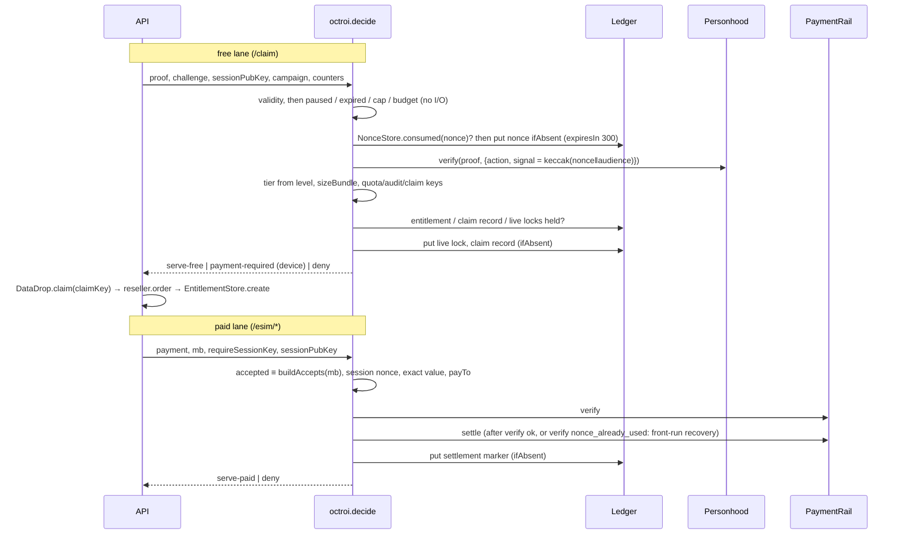

# `@ethglobal/octroi`

The proof-or-pay quota engine inside Recharge. It covers credential tiers, bundle sizing, pseudonymous keys, MAC-bound challenges, `decide()` (which turns a request into _serve free_, _serve paid_, _402_ or _deny_), the agent's `shouldTopUp`, the gift-reclaim rule, and the ledger stores. The stores are the only code in the repo that builds annotations or calls `ledger.put/query/update`.

The package is pure TypeScript. It does no network I/O and has no clock or randomness of its own. Everything external comes through the injected `Ledger`, `Personhood` and `PaymentRail` ports, `now()`, and `@ethglobal/crypto`. It imports `@ethglobal/protocol`, `@ethglobal/crypto` and the **types** of `@ethglobal/adapters` (root only, never `./live`).

```ts
import {
  decide,
  challenge,
  consumeChallenge,
  sizeBundle,
  shouldTopUp,
  decideGiftReclaim,
} from '@ethglobal/octroi';
import {
  EntitlementStore,
  NonceStore,
  GiftStore,
  CampaignStore,
  ReceiptStore,
  AgentPolicyStore,
} from '@ethglobal/octroi/store';
```

Binding spec: `docs/INTERFACES.md` §5 (with §13 A-1, A-3, A-4, A-8, A-9, A-13, A-14, A-17) and `docs/build-briefs/octroi-engine.md`.

## `decide()`: the order is the specification

```
0. request validity   request / payment / proof not an object ⇒ invalid-request (never a TypeError, RT-O-07);
                      both proof and payment ⇒ invalid-request; mb not an integer ⇒ invalid-request;
                      paid / 402 path: assertMbStep(mb, stepMb, maxMbPerPurchase) else invalid-request
1. FREE LANE (proof)
   a. no campaign ⇒ no-campaign; no challenge / sessionPubKey / counters ⇒ invalid-request;
      campaign fails campaignToPayload ⇒ invalid-request ('campaign'); counters not integers / bigints ≥ 0 ⇒
      invalid-request ('counters')                                                (RT-O-07)
      challenge.path ≠ '/claim' or audience ≠ AUDIENCE ⇒ invalid-proof            (T-21)
   b. counters, before anything is burned (T-24):
      paused ⇒ paused; now ≥ expiresAt ⇒ expired; claimsThisHour ≥ claimsPerHour ⇒ cap
      (a count from an earlier hour bucket counts as 0); spent + pricePerClaim > budget ⇒ budget
   c. consumeChallenge: replayed ⇒ replay; expired|invalid ⇒ invalid-proof; unavailable ⇒ ledger-unavailable
   d. personhood.verify(proof, { action, signal: signalFor(nonce, audience) })   (recomputed, T-19)
      already_verified ⇒ replay; any other throw ⇒ invalid-proof
   e. tier = tierFromLevel(result.level) (verifier only, T-22); mb = sizeBundle; 0 ⇒ payment-required
   f. keys: freeEntitlementKey (per campaign), campaignClaimKey, onchainClaimKey, claim-lock keys from quotaKey
      (a malformed verifier nullifier ⇒ invalid-proof 'verifier_nullifier', RT-O-07)
   g. existingEntitlement ∨ counters.claimed ∨ this campaign's entitlement ∨ this campaign's claim record ∨
      the human's live lock of any of the last 30 claim days ⇒ replay (T-18, RT-O-08; 33 parallel reads)
      (a read throws ⇒ ledger-unavailable)
   h. actionCheck(claimKey) false or throws ⇒ invalid-proof ('action')
   i. reserve, create-if-absent: live lock (until the entitlement's expiresAt), then the campaign claim record
      (until the campaign ends) — a lost race ⇒ replay 'claim_lock'; a write fails ⇒ ledger-unavailable (RT-O-03)
   j. serve-free { entitlement (pending-profile, holderHash), claimKey, campaignClaimKey, tier, mb }
2. PAID LANE (payment)
   a. payment.accepted deep-equals one of buildAccepts(deps, mb, { sessionKeyRequired }) by canonical
      JSON of the RAW echo (asset lower-cased; payTo lower-cased on EVM) ⇒ else requirements_mismatch (T-28)
      the payload fails paymentPayloadSchema (strict branches) ⇒ malformed_payload; from here on ONLY the
      parsed payload is used (RT-O-02)
   b. requireSessionKey: no sessionPubKey ⇒ invalid-request; EVM nonce ≠ sessionNonce(spk) ⇒ session_binding
      (T-32); Hedera ⇒ session_binding_unsupported (fail closed until the memo can be read [verify Wed])
   c. EVM: authorization.value ≠ amount (exact, T-26) ⇒ amount_mismatch; to ≠ payTo ⇒ recipient_mismatch
   d. payments.verify → !isValid / throws ⇒ invalid-payment          (settle is never called) — except
      invalidReason 'nonce_already_used', which continues to settle: the facilitator's front-run recovery (T-15)
   e. payments.settle → throws / malformed / !success (incl. settlement_pending) / network ≠ accepted /
      transaction not 32-byte hex on eip155 or 0.0.x@s.n on hedera / EVM payer ≠ authorization.from ⇒
      invalid-payment (T-27)
   f. settlement marker claim:HMAC('settle'‖network‖tx), create-if-absent, lives RECEIPT_TTL_S: taken ⇒
      invalid-payment 'nonce_already_used' (verify said so) or replay 'settlement'; write fails ⇒
      ledger-unavailable (RT-O-05)
   g. serve-paid { entitlement paid:<payer>:HMAC(network‖payer‖nonce), settlement, requirements }
3. NEITHER ⇒ payment-required (accepts = steps × price on every template)
```

`decide()` never throws for a business outcome. It throws only for configuration bugs, for example an accept template that fails the x402 schema. It writes the consumed-nonce entity (1c), the two claim locks (1i) and the settlement marker (2f), all create-if-absent. It never writes an entitlement, and it never calls the reseller, the chain or HCS. The API does those after `decide()` returns (ARCHITECTURE §2.1 steps 6–7).

**Top-ups:** the API calls `decide()` with the existing entitlement's `mb` request and ignores the `key` of the returned entitlement. It patches the existing entitlement with `EntitlementStore.patch` instead of creating a new one — preferably the function form `patch(key, (e) => ({ mbTotal: e.mbTotal + mb }))`, which is recomputed on every CAS retry so a concurrent top-up is never lost.

### Sequence



## `shouldTopUp` (evaluated top to bottom)

| Condition                                                                                     | Verdict                                                             |
| --------------------------------------------------------------------------------------------- | ------------------------------------------------------------------- |
| `stepPriceUsd6 ≤ 0 ∨ spentTodayUsd6 < 0 ∨ !isFinite(now)` (malformed input, RT-O-07)          | `{ buy:false, reason:'ok' }`                                        |
| `p.paused`                                                                                    | `{ buy:false, reason:'paused' }`                                    |
| `now ≥ e.expiresAt`                                                                           | `{ buy:false, reason:'expired' }`                                   |
| `p.topUpOnExpiry ∧ e.expiresAt − now ≤ p.expiryLeadS×1000 ∧ lastExpiryBought === e.expiresAt` | `{ buy:false, reason:'already-bought-for-expiry' }`                 |
| `p.topUpOnExpiry ∧ e.expiresAt − now ≤ p.expiryLeadS×1000`                                    | candidate `'expiry'`                                                |
| else `e.mbTotal − e.mbUsed ≤ p.thresholdMb`                                                   | candidate `'threshold'`                                             |
| else                                                                                          | `{ buy:false, reason:'ok' }`                                        |
| candidate ∧ `spentTodayUsd6 + stepPriceUsd6 > p.maxUsd6PerDay`                                | `{ buy:false, reason:'cap' }` (reaching the cap exactly is allowed) |
| candidate                                                                                     | `{ buy:true, mb: p.stepMb, reason, costUsd6: stepPriceUsd6 }`       |

"Day" is the UTC `dayBucket`. The agent records `lastExpiryBought = e.expiresAt` after an expiry purchase (T-30).

## `decideGiftReclaim` (evaluated top to bottom)

| Condition                                                                        | Verdict                                                                         |
| -------------------------------------------------------------------------------- | ------------------------------------------------------------------------------- |
| `!ledgerOk`                                                                      | deny `ledger-unavailable`                                                       |
| no receipt of kind `gift`, or that receipt has no `network` / `usd6`             | deny `unknown-gift`                                                             |
| `giftReceipt.payer?.toLowerCase() !== payer.toLowerCase()`                       | deny `not-payer`                                                                |
| any `gift-claim` receipt, or the escrow is still readable with `state:'claimed'` | deny `claimed`                                                                  |
| any `gift-reclaim` receipt                                                       | deny `already-reclaimed`                                                        |
| `escrow !== null` (still claimable)                                              | deny `too-early`                                                                |
| `now < claimBy` where `claimBy = giftReceipt.at + GIFT_CLAIM_WINDOW_S×1000`      | deny `too-early` (escrow dropped early, T-35)                                   |
| `now ≥ claimBy + GIFT_RECLAIM_WINDOW_S×1000`                                     | deny `window-closed`                                                            |
| `max(fee, 0) ≥ usd6`                                                             | deny `nothing-to-refund` (RT-O-09)                                              |
| else                                                                             | `refund { to: payer, network, usd6: usd6 − max(fee, 0), feeUsd6: max(fee, 0) }` |

## Other rules

- **`sizeBundle`** is `min(bundleMb[tier], ⌊8·idResale·1000 / (10·wholesale)⌋, 300)` in bigint arithmetic, with 1 GB = 1000 MB (A-1). `device` and `none` give 0. Wholesale ≤ 0 gives `min(bundleMb, 300)`. A resale price ≤ 0 or a non-integer configured size gives 0. Worked examples: $1.14/GB gives 300, $2.50/GB gives **160**, $5/GB gives 80.
- **Keys.** The **token model** (A-34, RT-O-01): an entitlement key is a bearer capability (`/me/:key`, top-ups, agent policy) and is never written to the ledger. Free: `ent:v1:` + `HMAC(secret, 'entfree' ‖ campaignId ‖ nullifier)` (per campaign). Paid: `paid:<payer>:` + `HMAC(secret, 'paid' ‖ network ‖ payer ‖ nonce)` (Hedera: nonce = keccak(tx)). Gift/card: `giftent:<giftId>` (API-built; derivable from the public gift entity — residual, see Decision 16). The ledger holds `entitlementIndex(key) = 'hk:' + sha256(utf8(key))` in the `key` annotation AND in `payload.key`; `getByKey` hashes the capability and refuses an `hk:` value. `quotaKey = HMAC(secret, 'quota' ‖ nullifier)` never leaves the process: it only keys the claim locks; `auditKey = HMAC(secret, 'audit' ‖ id)`, `campaignClaimKey = HMAC(audit, nullifier)`, `onchainClaimKey = keccak256(abi.encodePacked(bytes32 id, bytes32 cck))`. The HMACs run over bytes, so hex case does not matter. Inputs must be hex32 (`invalid_request` otherwise). Secrets shorter than 32 bytes throw `internal_error` (T-29).
- **Challenge.** `nonce = random16 ‖ HMAC(secret, random16 ‖ len‖audience ‖ len‖path ‖ u64be(exp) ‖ sessionPubKey)[0..16]`, `exp = now + 120 s` (a field > 255 bytes or a clock that is not a non-negative safe integer throws `RechargeError('invalid_request')`), `signal = keccak256(nonce ‖ utf8(audience))`. Issuing a challenge writes nothing. `consumeChallenge` checks, in order: MAC, session key, path ∈ `CHALLENGE_PATHS`, signal, expiry, skew (remaining life must be at most TTL + 5 s). It then checks and adds the nonce to the in-memory `Set` **synchronously, before the first await**, then reads the ledger, then writes the nonce entity create-if-absent with `expiresIn = NONCE_TTL_S` (300 s ≥ TTL + 5 s skew + ledger drift, RT-O-04; `now == exp` is still inside the window). A second process consuming the same nonce loses the create and gets `'replayed'` (RT-O-03). When the ledger fails it returns `'unavailable'` and the nonce stays in the cache (fail closed).
- **Stores.** Every lookup is `ledger.query({ annotations: { type, …filter }, limit })`. There is no `ledger.get` anywhere, so a caller-supplied entity key never resolves (T-36). An entity counts as live only if the ledger still holds it **and** its numeric `expiresAt` annotation is in the future (T-35); a non-numeric annotation counts as dead. Payloads are validated with the protocol schema on write and on read. A read also re-derives the annotations from the payload and drops the row if any stored annotation disagrees. Malformed rows read as `null` or are skipped. Two live rows for one lookup throw `internal_error`.

## Decisions (where this package goes beyond the spec text)

1. **Length-prefixed MAC fields.** The brief's plain concatenation `audience ‖ path` gives `('recharge/gift', '/claim')` and `('recharge', '/gift/claim')` the same MAC. Each string field is now `u8 length ‖ utf8`. The wire shape is unchanged.
2. **`consumeChallenge` also rejects a `signal` that is not `keccak(nonce ‖ audience)`.** `decide()` passes the _recomputed_ signal to `verify`, never the client's echo.
3. **`decide()` looks up `ent:v1:<quotaKey>` itself** in addition to honouring `existingEntitlement` and `counters.claimed`. The caller cannot know the quota key before `verify`, which runs inside `decide()`. So T-18 no longer depends on the caller remembering the lookup, or on the verifier being one-shot. If the lookup fails, the result is `ledger-unavailable`.
4. **Additive fields (no call site changes).** `OctroiDeps.planId?`: paid entitlements need a `planId`; the default is `''`. `OctroiDeps.nonceCache?`: the API passes its own bounded `Set`. When it is omitted, `decide()` keeps one self-pruning cache per ledger instance, so concurrent calls still share it (T-20). `buildAccepts(deps, mb, { sessionKeyRequired? })`: the 402 body and the paid-lane comparison must use the **same** `extra`.
5. **`accepts[].extra`** is the template's own keys plus `{ mb, stepMb, sessionKeyRequired }`. This binds the MB count into the offer the buyer signs against. Because the comparison runs on the raw echo, an extra key such as a v1 `maxAmountRequired` fails it.
6. **Settlement hardening (T-27).** A settlement is accepted only if it is schema-valid, its `network` equals the accepted network, its transaction id has the right format for the network, and (on EVM) its `payer` equals `authorization.from`. Hedera paid keys use `keccak256(utf8(transaction))` as the nonce part, because a Hedera payload has no EIP-3009 nonce.
7. **Hedera on LPA routes fails closed.** octroi cannot read the transaction memo without the Hedera SDK, so `requireSessionKey` combined with a Hedera payload is denied (`session_binding_unsupported`). Plain Hedera top-ups work. Revisit after the Wednesday recording.
8. **A stale hour bucket counts as 0.** If `counters.hourBucket` is older than `hourBucket(now)`, `claimsThisHour` belongs to a past hour, matching DataDrop's reset.
9. **Stores.** `create` refuses a live duplicate logical key (`replay`) and an already-dead lifetime (`invalid_request`). `CampaignStore.put` and `AgentPolicyStore.put` upsert, re-deriving the lifetime. `EntitlementStore.patch` keeps the logical key, never resurrects an expired entity (`not_found`), and refuses `patch.expiresAt` unless it equals `opts.expiresAt`. `NonceStore.consumed` counts any live row under the key, including a malformed one (fail closed). `GiftStore.markClaimed` is idempotent for the same entitlement key and throws `already_claimed` for a different one.
10. **Gift reclaim.** An escrow that is still readable with `state:'claimed'` gives `claimed`. A gift receipt without `network` or `usd6` gives `unknown-gift`. A fee ≥ `usd6` is `deny 'nothing-to-refund'` (RT-O-09, A-39: no 0n transfer, no `gift-reclaim` receipt; the API answers 410). A negative fee is treated as 0. `claimBy` is derived from `receipt.at + GIFT_CLAIM_WINDOW_S`, so if claim windows ever become per-gift this will drift (Low).
11. **`tierFromLevel`** maps any value outside the four levels to `none`, which sizes to 0.
12. **Atomic stores (RT-O-03/05/06, A-32).** Every `Repo.create` is a ledger create-if-absent (`put({ ifAbsent: true })`; a conflict is `RechargeError('replay')`), so N concurrent creates of one logical key — in one process or several — leave exactly one row. Every read-modify-write (`EntitlementStore.patch`, `GiftStore.markClaimed`, `upsert`, `ReceiptStore.patch`) is a compare-and-swap on the version it read (`update(…, { ifVersion })`), re-read and retried up to 8 times; the merge is applied to the FRESH row, so a usage patch and a top-up both land, and of two redeemers of one gift exactly one wins. Cross-process on Arkiv this is best effort (no conditional write; the adapter's re-read-and-tombstone `[verify Wed]`): wave 2 runs one API writer process (THREAT-MODEL §8).
13. **Claim locks (RT-O-03, RT-O-08, A-33).** The free lane's replay check is the ledger's, not the caller's: `decide()` reads this campaign's entitlement, this campaign's claim record and the human's live lock of each of the last 30 claim days, and before `serve-free` writes, create-if-absent, the live lock for today (lives until the entitlement would expire) and the campaign claim record (until the campaign ends, ≤ 180 d). One human, two campaigns, concurrently ⇒ one serve, one `replay` — before any sponsor pays. Same campaign after the bundle expired ⇒ `replay` inside `decide()`. The live lock is keyed by the claim DAY, so two claims ≥ 1 day apart share no identifier. Consequence (fail closed, by design): if the API saga fails after `serve-free` (e.g. `DataDrop.claim` reverts), the human's free slot stays taken until the would-be expiry; the paid lane is unaffected. `CampaignCounters.claimed` stays as optional caller knowledge.
14. **One serve per payment (RT-O-05, T-15, A-40).** A verify answering `nonce_already_used` no longer ends the paid lane: `settle()` runs, and a recovering facilitator (`SelfRunFacilitator`) returns the executed transfer, so a human whose authorization was front-run is served — once. Before `serve-paid` the settlement marker `claim:HMAC('settle' ‖ network ‖ tx)` is created-if-absent: a second request for the same transaction is refused (`invalid-payment 'nonce_already_used'` when verify said so, else `replay 'settlement'`). Picked: deny, not "the same entitlement again" — the API's top-up path ignores the returned key, so a repeat must never reach `patch`. A marker write failure denies `ledger-unavailable`; the retry is served once through the recovery. `MockPaymentRail` still does not model recovery (its settle burns the nonce), which only makes local runs stricter.
15. **Validate, then use (RT-O-02, A-40).** The accepted echo is compared RAW (an added key fails); then the payload is strictly parsed (`evmExactPayloadSchema` / `hederaExactPayloadSchema` are `z.strictObject`), and `sessionBound`, the EVM checks, `verify`/`settle` and the entitlement key see only the parsed value. A hybrid Hedera payload with a decoy `authorization` is `malformed_payload`.
16. **Token model (RT-O-01, A-34).** See "Keys" above. Why sha256 and not an HMAC for the index: every store instance (API, agent, tests) must index identically without the secret, and every free/paid capability is ≥ 256 bits of HMAC output, so the digest cannot be inverted; the index equals a receipt's `entitlementKeyHash`. Residuals, not fixed here: `giftent:<giftId>` is derivable from the public gift entity (giftId is in its payload) — the gift/card capability needs an HMAC'd key in the API; `AgentPolicyWire.entitlementKey` is stored in clear (the agent's watch list reads it) — moving it to the index needs an index-based read in the agent. `getByIccidHash` / `expiringWithin` return the index as `payload.key`; `patch` accepts it (server-internal), `getByKey` does not.
17. **Holder binding (T-73 b, A-35).** Free entitlements carry `holderHash = sha256(utf8(key) ‖ sessionPubKey)` of the claiming session. `mayRegisterPolicy()` lets the FIRST agent-policy registration of such an entitlement through only with that session's public key; paid ⇒ the payer; an existing policy ⇒ its owner. Entitlements without a holderHash (gift/card, pre-A-35) keep first-registration. The PWA must keep the claim session's PUBLIC key with the entitlement and send it as `sessionPubKey` on the first PUT.
18. **Typed inputs (RT-O-07, A-41).** `decide()` validates the request shape, the campaign (`campaignToPayload`) and the counters before anything is burned; a malformed verifier nullifier is a deny after verify, not a throw. `challenge()` throws `RechargeError('invalid_request')`, never `RangeError`. `consumeChallenge` returns `'invalid'` for a clock that is not a non-negative safe integer (NaN used to pass both expiry comparisons). `shouldTopUp` never buys on a non-positive step price, a negative spend or a non-finite clock.
19. **Nonce lifetime (RT-O-04, A-37).** The consumed-nonce entity lives `NONCE_TTL_S = 300 s` from consume and records `issuedAt`. The brief's `now ≥ exp ⇒ expired` was NOT adopted: the finding and its tests keep `now > exp ⇒ expired` (the boundary is covered by the longer entity instead).
20. **Cross-package changes made here (recorded in INTERFACES §13 A-32…A-41).** protocol: strict payload branches, `ENTITY_TYPES += 'claim'`, `claimSchema`, `keys.claim`, `NONCE_TTL_S`, `RECEIPT_TTL_S = 38 d`, `nonceSchema.issuedAt?`, `entitlementSchema.holderHash?`, `agentPolicyPutSchema.sessionPubKey?`, `ADAPTER_CODE_MAP.conflict`. adapters: `ifAbsent`, `ifVersion`, `version`, `'conflict'` on the Ledger port, `InMemoryLedger` + `ArkivLedger` + `describeLedger`. services/api (minimal): `RECLAIM_DENY_CODES['nothing-to-refund']`, `MeCache` keyed by the index, `mayRegisterPolicy` in PUT /agent/policy, tests that pinned the old findings flipped, `openapi.json` regenerated.

## Notes for the red team (`security/redteam/attacks/wave1-octroi.md`)

- Each attack is encoded in `test/attack/*.attack.test.ts`. The shared fixture at `test/attack/fixture.ts` re-exports `test/helpers.ts`.
- The script's `Object.create(d.ledger, { put })` wrapper does not work with `InMemoryLedger`, which keeps its state in `#private` fields: inherited methods throw a `TypeError`. Use a delegating wrapper (`ledgerWith` in the helpers).
- The script's accept template has no `extra`. The x402 schema requires `extra.{name, version}` on EVM, so the helpers use `USDC_EIP712_DOMAIN`.
- O8: `decide()` writes the consumed nonce (T-20), the claim locks (free) and the settlement marker (paid) — controls, never an entitlement.
- Wave 1 (RT-O-01…09) is fixed; the attack tests in `test/redteam` are passing regressions named `… [RT-O-0N]`, edges in `test/regression/redteam-wave1.test.ts`.
- T-79 (`$creator` filtering) needs the creator on `LedgerEntity`, which the port does not expose, so it is the `ArkivLedger` adapter's job. The stores add two layers on top: the annotation/payload consistency check, and the duplicate-row ⇒ `internal_error` rule.
- `MockPersonhood` has no `maxVerifications` option. Its default is one-shot. O1 runs against both a permissive stub and the one-shot mock.

## Development

```sh
pnpm --filter @ethglobal/octroi test       # vitest: unit, store, property (fast-check ≥ 200 runs), attack, design bans
pnpm --filter @ethglobal/octroi coverage   # v8, thresholds 100 % lines/branches/functions/statements
pnpm --filter @ethglobal/octroi typecheck
pnpm --filter @ethglobal/octroi build      # dist/ (".", "./store")
```
